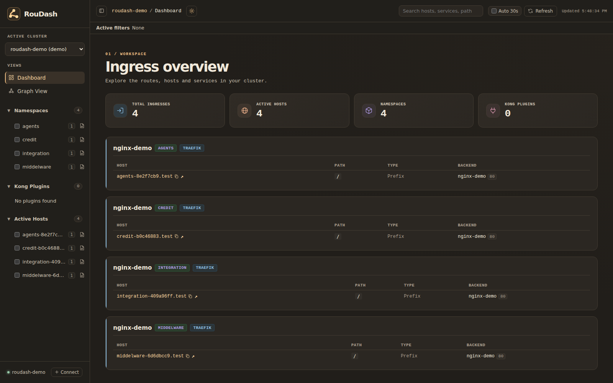
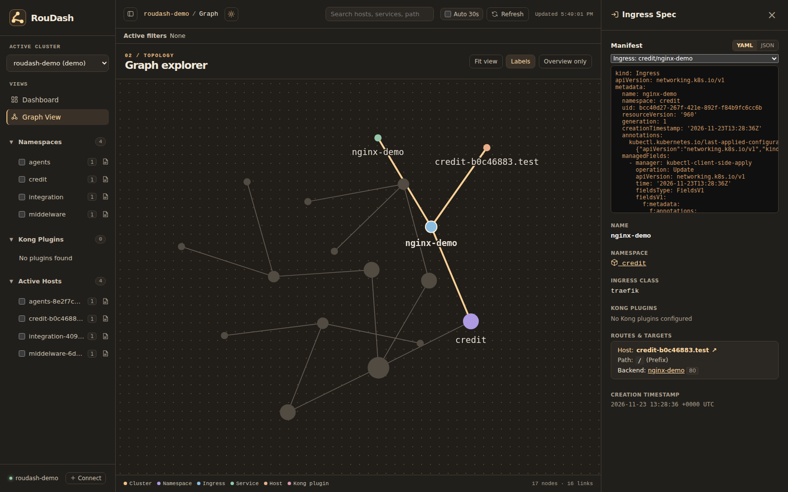

# RouDash

RouDash shows how HTTP traffic is routed in Kubernetes. Search for a hostname or path in the dashboard, then open **Graph View** to see the Ingress, its namespace, the backend Services it references, and any Ingress plugins attached to it.

## Explore the demo

**Dashboard.** The demo has four Ingresses across four namespaces. Each route shows the hostname and path alongside the backend Service and port.



**Graph View.** Select the `nginx-demo` Ingress in the `credit` namespace to highlight its host, namespace, and backend Service. The details panel shows the Ingress manifest and where the `/` route points.



## Quick start

You only need Docker to open the dashboard. To see routes, you also need a kubeconfig for a cluster that the container can reach.

**1. Start RouDash.** Choose either method to run the [joseco/roudash image from Docker Hub](https://hub.docker.com/r/joseco/roudash).

**Docker CLI:**

```sh
docker run -d --pull=always --name roudash -p 127.0.0.1:8080:8080 joseco/roudash:latest
```

**Docker Compose:** Save this as `compose.yml`:

```yaml
services:
  roudash:
    image: joseco/roudash:latest
    ports:
      - "127.0.0.1:8080:8080"
```

From the directory containing `compose.yml`, run:

```sh
docker compose up -d --pull always
```

**2. Open [http://127.0.0.1:8080](http://127.0.0.1:8080).** You should see the connection screen. To check from a terminal, run:

```sh
curl -sS -o /dev/null -w '%{http_code}\n' http://127.0.0.1:8080/healthz
```

A `200` means the dashboard is running, even before you connect a cluster. The port is bound to localhost because the dashboard has no user login.

**3. Connect your cluster.** Choose **Upload Kubeconfig**, select a YAML or JSON file (up to 1 MiB), and connect. If the file contains multiple contexts, select the one you want to explore. The Kubernetes identity needs permission to `list` `ingresses.networking.k8s.io` across all namespaces.

If the dashboard opens but cannot load routes, check the kubeconfig's `server` address: `127.0.0.1` inside the container points to the container itself. Use a Kubernetes API endpoint reachable from the container. Include credentials and certificate data in the kubeconfig; host file paths and `exec` credential plugins are not supported.

## Stop and remove the container

- **Docker CLI:** `docker rm -f roudash`
- **Docker Compose:** Run `docker compose down` from the directory containing `compose.yml`.

The quick start keeps uploaded kubeconfigs in memory. After a restart, upload the file again to reconnect.
